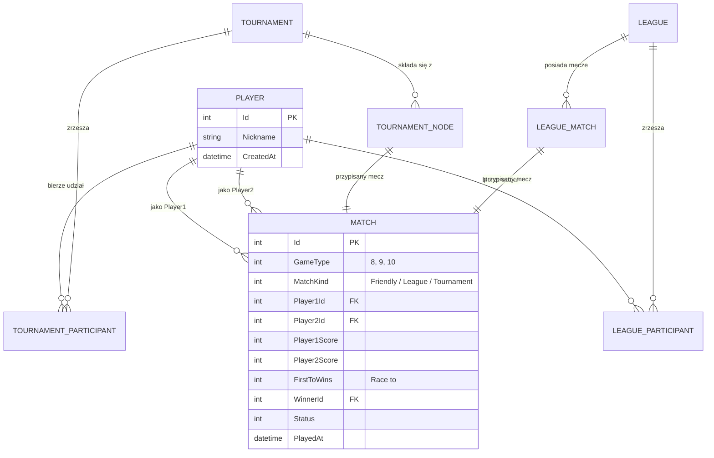

# Plan Projektu Aplikacji PoolNet (.NET 10)

Dokument stanowi szczegółowy plan architektoniczny i implementacyjny aplikacji internetowej **PoolNet**, służącej do ewidencji i zarządzania rozgrywkami bilardowymi (odmiany 8, 9 i 10).

---

## 1. Wymagania i Założenia Systemu

- **Środowisko i technologia bazowa:** .NET 10 (C# 14), ASP.NET Core MVC.
- **Baza danych:** SQLite z wykorzystaniem Entity Framework Core 10.
- **Architektura:** Warstwowa (Clean Architecture / Onion Architecture) z zachowaniem pryncypiów **SOLID**.
- **Jakość kodu:** Pokrycie logiki biznesowej testami jednostkowymi (**xUnit**, **FluentAssertions**, **Moq**).
- **Zasady dostępu:**
  - **Administrator:** Jedyny użytkownik z możliwością logowania; posiada pełne prawa zapisu (dodawanie graczy, tworzenie lig i turniejów, rejestracja wyników meczów).
  - **Użytkownicy niezalogowani (Goście):** Tryb **tylko do odczytu** – swobodne przeglądanie profili graczy, statystyk, tabel ligowych, drabinek pucharowych i historii meczów.

---

## 2. Architektura Systemu i Zgodność z SOLID

Projekt zostanie zorganizowany w przejrzystą strukturę solucji (.sln):

```
PoolNet/
├── src/
│   ├── PoolNet.Domain/          # Encje domenowe, Enumy, interfejsy reguł biznesowych
│   ├── PoolNet.Application/     # Usługi aplikacyjne (DTOs, serwisy lig, turniejów, statystyk)
│   ├── PoolNet.Infrastructure/  # EF Core, AppDbContext, migracje SQLite, repozytoria
│   └── PoolNet.Web/             # ASP.NET Core MVC (Kontrolery, Widoki Razor, ViewModele, Autoryzacja)
└── tests/
    └── PoolNet.UnitTests/       # Testy jednostkowe logiki biznesowej
```

### Mapowanie zasad SOLID w projekcie:

1. **S – Single Responsibility Principle (Zasada Jednej Odpowiedzialności):**
   - Osobne serwisy do kalkulacji statystyk (`PlayerStatisticsService`), generowania terminarza ligowego (`LeagueScheduleGenerator`), obsługi drabinki pucharowej (`TournamentBracketService`) oraz uwierzytelniania.
   - Kontrolery MVC odpowiadają wyłącznie za obsługę żądań HTTP i delegację do warstwy aplikacji.
2. **O – Open/Closed Principle (Zasada Otwarte/Zamknięte):**
   - Odmiany bilarda (8, 9, 10) oraz reguły punktacji ligowej zdefiniowane w sposób umożliwiający łatwe dodanie kolejnych wariantów (np. 14.1, Snooker) bez modyfikacji istniejącego silnika meczowego.
3. **L – Liskov Substitution Principle (Zasada Podstawienia Liskov):**
   - Spójna hierarchia meczów lub interfejsów (`IMatch`, `IMatchRuleValidator`) – każdy typ meczu (towarzyski, ligowy, pucharowy) spełnia te same reguły bazowe (np. wyłonienie zwycięzcy na podstawie osiągniętego progu wygranych partii).
4. **I – Interface Segregation Principle (Zasada Segregacji Interfejsów):**
   - Wąskie interfejsy dostosowane do konkretnych potrzeb odbiorców, np. `IReadOnlyPlayerRepository`, `IPlayerStatisticsCalculator`, `ITournamentManager`.
5. **D – Dependency Inversion Principle (Zasada Odwrócenia Zależności):**
   - Warstwy wyższe zależą od abstrakcji (interfejsów z `Domain`/`Application`), a nie od konkretnych implementacji (np. `Infrastructure` dostarcza implementację `AppDbContext` i repozytoriów wstrzykiwanych przez Dependency Injection w `Program.cs`).

---

## 3. Model Danych (Baza SQLite / EF Core)

### 3.1. Główne Encje

- **`Player` (Gracz):**
  - `Id` (int)
  - `Nickname` (string, unikalny pseudonim identyfikujący gracza)
  - `CreatedAt` (DateTime)
  - Relacje do meczów (jako Player 1 lub Player 2).
- **`BilliardGameType` (Enum):**
  - `EightBall` (Ósemka)
  - `NineBall` (Dziewiątka)
  - `TenBall` (Dziesiątka)
- **`Match` (Mecz bilardowy):**
  - `Id` (int)
  - `GameType` (`BilliardGameType`)
  - `MatchKind` (`Friendly`, `League`, `Tournament`)
  - `Player1Id`, `Player2Id`
  - `Player1Score`, `Player2Score` (liczba wygranych partii)
  - `FirstToWins` (Race to – do ilu wygranych partii toczy się mecz)
  - `WinnerId` (nullable int – wyliczany po zakończeniu)
  - `Status` (`Scheduled`, `InProgress`, `Completed`)
  - `PlayedAt` (DateTime)
- **`Tournament` (Turniej pucharowy):**
  - `Id` (int)
  - `Name` (string)
  - `GameType` (`BilliardGameType`)
  - `RaceTo` (domyślny próg partii)
  - `Status` (`Draft`, `InProgress`, `Finished`)
  - `WinnerId` (nullable int)
  - `TournamentMatches` (drabinka z rundami: 1/8, 1/4, 1/2, Finał, powiązania `NextMatchId`).
- **`League` (Liga):**
  - `Id` (int)
  - `Name` (string)
  - `GameType` (`BilliardGameType`)
  - `RaceTo` (liczba wygranych partii w meczu)
  - `Status` (`Active`, `Completed`)
  - `Participants` (kolekcja graczy w lidze)
  - `LeagueMatches` (mecze ligowe z numerem kolejki i oznaczeniem mecz/rewanż).

### 3.2. Diagram Encji (ERD)



---

## 4. Moduły Aplikacji i Logika Biznesowa

### 4.1. Moduł Meczów Towarzyskich (Friendly Matches)
- Wybór dwóch graczy z listy aktywnych.
- Wybór odmiany (8, 9 lub 10).
- Ustalenie z góry parametru **"Do ilu wygranych partii" (Race To)** – np. do 5 wygranych partii.
- Formularz wprowadzania wyniku dostępny dla Administratora.
- Walidacja reguł:
  - Brak remisów (zwycięzca musi osiągnąć dokładnie ustaloną liczbę wygranych partii, np. 5:3, 5:4).
  - Wynik przegranego musi być mniejszy niż ustalony próg partii.

### 4.2. Moduł Ligi Bilardowej (System Kołowy – Mecz i Rewanż)
- Tworzenie nowej ligi z określoną odmianą bilarda i parametrem `Race To`.
- Wybór uczestników ligi.
- **Generator terminarza (Algorytm Round Robin x2):**
  - Generowanie kolejek spotkań w taki sposób, aby każdy gracz rozegrał z każdym przeciwnikiem dokładnie **dwa mecze** (mecz i rewanż).
- **Tabela ligowa generowana dynamicznie na podstawie rozegranych meczów:**
  - Pozycja, Gracz, Mecze rozegrane, Zwycięstwa, Porażki, Partie zdobyte, Partie stracone, Bilans partii (+/-), Punkty (np. 3 pkt za zwycięstwo, 0 za porażkę).

### 4.3. Moduł Turnieju Pucharowego (Single Elimination)
- Tworzenie turnieju (Nazwa, Odmiana gry, zasada Race To, lista graczy).
- **Generator drabinki (Bracket Generator):**
  - Drabinka pojedynczej eliminacji (Single Elimination) na 4, 8, 16 lub 32 graczy (z obsługą "wolnego losu" / BYE, gdy liczba graczy nie jest potęgą dwójki).
  - Prezentacja wizualna drabinki (Runda 1 -> Ćwierćfinały -> Półfinały -> Finał).
- **Progresja zwycięzców:**
  - Po zatwierdzeniu wyniku meczu przez Administratora zwycięzca automatycznie awansuje do kolejnego węzła drabinki.
  - Ostatni mecz wyłania triumfatora turnieju.

### 4.4. Profil Gracza i Statystyki
- Szczegółowy widok gracza (`/Players/Details/{id}`):
  - Podstawowe informacje (Pseudonim / Nickname, data dodania gracza do systemu).
  - **Statystyki ogólne oraz w podziale na odmiany (8, 9, 10):**
    - Liczba meczów (ogółem, wygrane, przegrane, % zwycięstw).
    - Bilans partii (frames won / frames lost, ratio).
    - Skuteczność w poszczególnych trybach (towarzyskie vs ligowe vs turniejowe).
  - **Historia meczów:**
    - Pełna lista wszystkich rozegranych pojedynków z datą, rywalem, odmianą, trybem i ostatecznym wynikiem.
  - **Osiągnięcia i pozycje:**
    - Aktualne i historyczne pozycje w ligach.
    - Rezultaty w turniejach pucharowych (np. Mistrz, Finalista, Półfinał).

### 4.5. Uwierzytelnianie i Bezpieczeństwo
- **Pojedynczy Administrator:**
  - Uwierzytelnianie oparte na ciasteczkach (Cookie Authentication) w ASP.NET Core z bezpiecznym hashowaniem hasła (PBKDF2 / ASP.NET PasswordHasher).
  - Domyślne konto administratora konfigurowane przez `appsettings.json` lub bezpieczny seeder bazy danych.
- **Autoryzacja:**
  - Akcje modyfikujące (POST, PUT, DELETE, `Create`, `Edit`, `RecordScore`) zabezpieczone atrybutem `[Authorize(Roles = "Admin")]`.
  - Widoki Razor dostosowują interfejs (przyciski "Dodaj wynik", "Utwórz ligę" widoczne tylko po zalogowaniu).
  - Goście mają pełny dostęp do wszystkich widoków informacyjnych (`[AllowAnonymous]`).

---

## 5. Strategia Testów Jednostkowych (xUnit)

Warstwa testów `PoolNet.UnitTests` pokryje kluczowe reguły domenowe:

1. **Testy logiki meczowej (`MatchTests`):**
   - Walidacja wyniku "Race to" (np. próba zapisu wyniku 5:5 przy Race to 5 rzuca wyjątek domenowy).
   - Poprawne ustalenie zwycięzcy na podstawie wprowadzonych partii.
   - Niedopuszczenie do rozegrania meczu gracza z samym sobą.
2. **Testy generatora ligowego (`LeagueScheduleGeneratorTests`):**
   - Weryfikacja, że każdy gracz gra z każdym dokładnie 2 mecze (mecz i rewanż).
   - Weryfikacja liczby wszystkich wygenerowanych meczów dla $N$ graczy: $N \times (N - 1)$.
   - Test kalkulatora tabeli ligowej (poprawne sortowanie po punktach, bilansie partii i bezpośrednich pojedynkach).
3. **Testy silnika turniejowego (`TournamentServiceTests`):**
   - Poprawne utworzenie drabinki dla różnej liczby graczy (np. 4, 8, 16 uczestników).
   - Prawidłowe przepychanie zwycięzcy do następnej rundy po wpisaniu wyniku.
   - Zakończenie turnieju i ustalenie mistrza po finale.
4. **Testy statystyk gracza (`PlayerStatisticsCalculatorTests`):**
   - Prawidłowe zliczanie rozegranych meczów, win-rate oraz bilansu partii per odmiana bilarda.

---

## 6. Etapy Realizacji (Harmonogram Wdrożenia)

| Etap | Zakres prac | Rezultat |
| :--- | :--- | :--- |
| **Krok 1** | Inicjalizacja solucji .NET 10, podział na projekty (`Domain`, `Application`, `Infrastructure`, `Web`, `UnitTests`), konfiguracja pakietów NuGet. | Skompilowana struktura solucji z DI. |
| **Krok 2** | Implementacja encji domenowych, `AppDbContext` EF Core, konfiguracja SQLite, migracje bazodanowe i seeder danych startowych. | Działająca baza SQLite z relacjami. |
| **Krok 3** | Implementacja logiki biznesowej (terminarz ligowy, drabinka turniejowa, walidacja partii bilardowych) + testy jednostkowe xUnit. | 100% zielonych testów logiki biznesowej. |
| **Krok 4** | Konfiguracja uwierzytelniania Cookie Auth dla administratora, zabezpieczenie ścieżek `[Authorize]`. | Bezpieczny panel logowania admina. |
| **Krok 5** | Moduł Graczy i Meczów Towarzyskich w ASP.NET MVC (CRUD graczy, wybór odmiany 8/9/10, ustalanie partii do wygranej, zapis wyniku). | Działające mecze towarzyskie i lista graczy. |
| **Krok 6** | Moduł Turniejów Pucharowych (kreator turnieju, widok drabinki pucharowej, wprowadzanie wyników rundy i automatyczny awans). | Kompletne turnieje pucharowe. |
| **Krok 7** | Moduł Ligi (kreator ligi, generator mecz/rewanż, terminarz kolejek, wprowadzanie wyników, dynamiczna tabela ligowa). | Działająca liga bilardowa. |
| **Krok 8** | Widok Szczegółów Gracza (karta profilowa, historia meczów, statystyki per odmiana, osiągnięcia w ligach i turniejach). | Pełny podgląd profilu gracza. |
| **Krok 9** | Dopracowanie UI (Bootstrap 5, estetyczne tabele bilardowe, responsywność), testy integracyjne i weryfikacja całościowa. | Gotowa do uruchomienia aplikacja PoolNet. |

---

## 7. Podsumowanie

Przedstawiony plan w 100% realizuje wymagania określone w specyfikacji `poolnet.txt`. Gwarantuje stworzenie nowoczesnej, czystej architektonicznie aplikacji w **.NET 10** z testami jednostkowymi, bazą **SQLite**, bezpiecznym podziałem ról (jeden admin z prawem zapisu, publiczny podgląd dla gości) oraz pełną obsługą odmian bilarda 8, 9 i 10 w trybach towarzyskim, ligowym (mecz i rewanż) i pucharowym.
